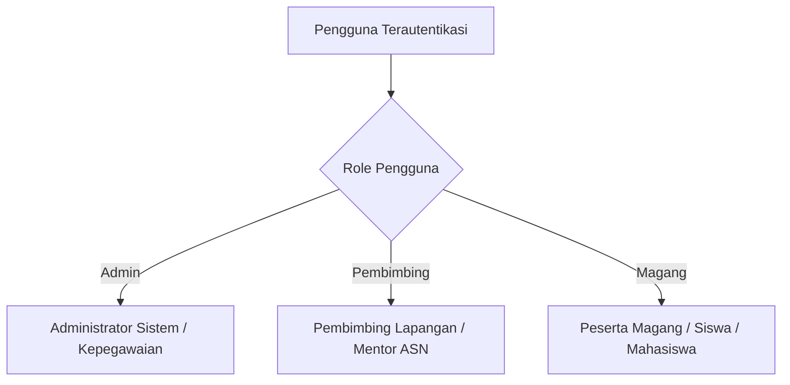
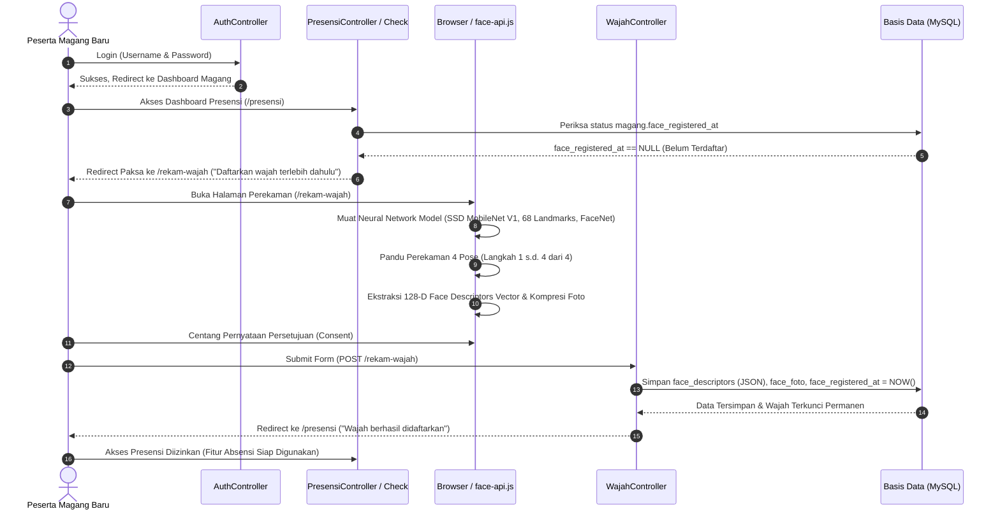
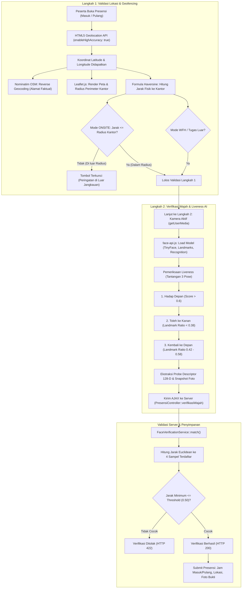
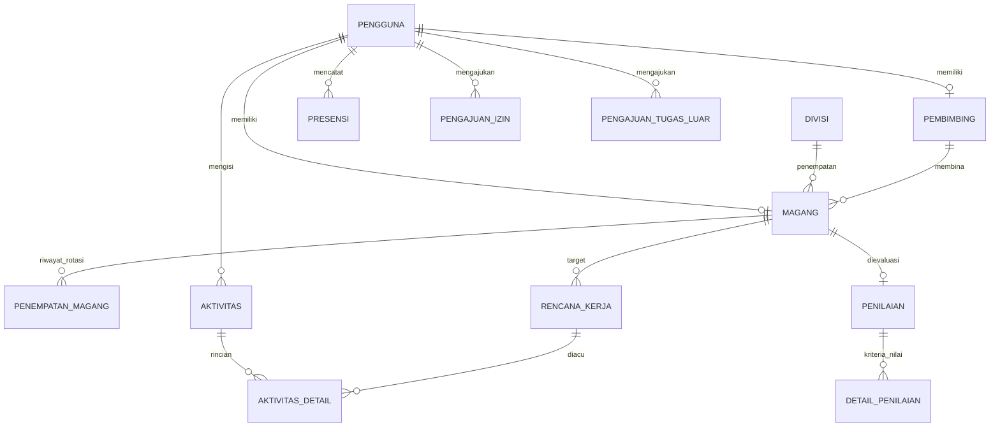

# DOKUMEN RANGKUMAN EKSEKUTIF & SPESIFIKASI SISTEM (PRD)
## SISTEM INFORMASI PRESENSI DIGITAL & MONITORING AKTIVITAS MAGANG
### Dinas Komunikasi dan Informatika Provinsi Kalimantan Selatan

---

> **Catatan Penggunaan**:  
> Dokumen ini disusun sebagai panduan menyeluruh untuk keperluan **Seminar Penyampaian Hasil / Ujian Sidang Akhir Magang / Tugas Akhir**. Berisi penjelasan latar belakang, arsitektur teknologi, hak akses pengguna, alur kerja bisnis, struktur data, format pelaporan resmi kedinasan, hingga panduan teknis presentasi (*talking points* & tanya-jawab penguji).

---

## DAFTAR ISI
1. [Profil Sistem & Ringkasan Eksekutif](#1-profil-sistem--ringkasan-eksekutif)
2. [Latar Belakang & Identifikasi Masalah](#2-latar-belakang--identifikasi-masalah)
3. [Tujuan Pengembangan Sistem](#3-tujuan-pengembangan-sistem)
4. [Tumpukan Teknologi (Technology Stack)](#4-tumpukan-teknologi-technology-stack)
5. [Aktor Sistem & Hak Akses (Role-Based Access Control)](#5-aktor-sistem--hak-akses-role-based-access-control)
6. [Fitur Utama & Alur Bisnis (Core Workflow)](#6-fitur-utama--alur-bisnis-core-workflow)
   - 6.1. Integrasi Pendaftaran & Penempatan Magang
   - 6.2. Riwayat Rotasi Magang Antar Divisi/Pembimbing
   - 6.3. Alur Login Awal & Pendaftaran Wajah Biometrik (Onboarding)
   - 6.4. Presensi Cerdas (Geofencing GPS & Verifikasi Wajah)
   - 6.5. Perhitungan Jam Kerja & Rumus Skor Presensi (PresensiScoreService)
   - 6.6. Manajemen Hari Libur Nasional & Integrasi API Indonesia (HariLiburService)
   - 6.7. Modul Pengajuan Izin, Sakit, & Tugas Luar
   - 6.8. Monitoring Aktivitas Harian Berbasis Rencana Kerja (Format 6 Kolom)
   - 6.9. Rumus Lengkap Perhitungan Penilaian Akhir Magang Terintegrasi
   - 6.10. Penerbitan Sertifikat Kelulusan PKL Digital
7. [Format Dokumen Cetak Kedinasan (Standardisasi mPDF A4)](#7-format-dokumen-cetak-kedinasan-standardisasi-mpdf-a4)
8. [Arsitektur Basis Data & Entitas Utama](#8-arsitektur-basis-data--entitas-utama)
9. [Panduan Presentasi Seminar Hasil (Presentation Cheat Sheet)](#9-panduan-presentasi-seminar-hasil-presentation-cheat-sheet)
10. [Prediksi Pertanyaan Penguji & Jawaban Solutif](#10-prediksi-pertanyaan-penguji--jawaban-solutif)
11. [Kesimpulan & Manfaat Implementasi](#11-kesimpulan--manfaat-implementasi)

---

## 1. Profil Sistem & Ringkasan Eksekutif

- **Nama Aplikasi**: Sistem Informasi Presensi Digital & Monitoring Aktivitas Magang (SI-PRESENSI MAGANG).
- **Instansi Mitra/Penerapan**: Dinas Komunikasi dan Informatika (Diskominfo) Pemerintah Provinsi Kalimantan Selatan.
- **Deskripsi Singkat**:  
  Platform terpadu berbasis web yang mendigitalkan seluruh siklus hidup peserta magang (PKL), mulai dari penempatan awal, absensi harian berbasis lokasi (*geofencing GPS*) dan verifikasi wajah (*biometric camera*), pencatatan capaian tugas harian berbasis rencana kerja, pengajuan tugas luar/izin/sakit, evaluasi penilaian akhir bertingkat, hingga penerbitan dokumen laporan kedinasan resmi dan sertifikat kelulusan digital siap cetak format A4.

---

## 2. Latar Belakang & Identifikasi Masalah

Sebelum sistem ini dibangun, pengelolaan peserta magang di lingkungan Diskominfo Prov. Kalsel masih menghadapi beberapa kendala konvensional:

1. **Rentan Terjadi Kecurangan Presensi**: Presensi manual atau pencatatan spreadsheet rentan titip absen atau pengisian kehadiran fiktif saat peserta tidak berada di kantor.
2. **Monitoring Pekerjaan Bersifat Abstrak**: Peserta kerap melaporkan aktivitas dengan istilah umum tanpa rencana kerja yang jelas, atau menggunakan estimasi persentase yang sulit diverifikasi kebenarannya oleh pembimbing.
3. **Pengelolaan Rotasi Divisi yang Rentan Data Hilang**: Peserta magang sering dirotasi dari satu divisi/bidang ke bidang lain. Sistem manual menyulitkan tracking: siapa pembimbing lama, siapa pembimbing baru, dan bagaimana riwayat kerja di masing-masing bidang.
4. **Perhitungan Nilai Kehadiran Belum Objektif**: Menghitung akumulasi keterlambatan, jam kerja efektif, izin, sakit, dan tugas luar ke dalam komponen nilai akhir membutuhkan waktu lama dan rawan kekeliruan hitung manual.
5. **Format Laporan dan Sertifikat Belum Terstandarisasi**: Rekap laporan kegiatan dan presensi sering dibuat manual dengan format berbeda-beda, tidak seragam dengan standar persuratan kedinasan (Kop Surat Pemprov, Tanda Tangan Ganda Pembimbing & Kepala Bidang, serta pengesahan Kepala Dinas).

---

## 3. Tujuan Pengembangan Sistem

1. **Meningkatkan Integritas Presensi**: Memastikan kehadiran peserta tervalidasi secara valid melalui koordinat lokasi radius kantor (Geofencing) dan pencocokan biometrik wajah.
2. **Transparansi & Akuntabilitas Aktivitas Harian**: Menyediakan mekanisme pelaporan rencana kerja yang berorientasi output nyata (**Selesai** / **Belum**) dengan kewajiban mencantumkan alasan kendala apabila belum selesai.
3. **Otomasi Manajemen Rotasi & Penempatan**: Memfasilitasi perpindahan divisi dan pembimbing secara dinamis tanpa merusak integritas riwayat presensi maupun aktivitas sebelumnya.
4. **Otomasi Kalkulasi Penilaian Terintegrasi**: Menggabungkan penilaian kedisiplinan (dihitung otomatis dari log jam kerja presensi) dengan penilaian kompetensi/sikap dari pembimbing lapangan.
5. **Standarisasi Dokumen Resmi Instansi**: Menyediakan fitur cetak otomatis PDF ukuran A4 (Presensi, Log Aktivitas 6 Kolom, Lembar Penilaian, dan Sertifikat Kelulusan) yang telah disesuaikan dengan tata naskah dinas Pemprov Kalsel.

---

## 4. Tumpukan Teknologi (Technology Stack)

Sistem ini mengintegrasikan arsitektur modern berbasis PHP Laravel di sisi backend dan arsitektur *client-side AI & geospatial processing* di sisi frontend untuk menjamin keamanan, performa tinggi, dan efisiensi sumber daya server:

| Lapisan (Layer) | Komponen / Library / API | Versi / Spesifikasi | Peran & Fungsi dalam Sistem |
|---|---|---|---|
| **Backend Core** | **Laravel Framework** | v11 / v12 (PHP 8.3) | Arsitektur MVC, Eloquent ORM, Routing, REST API, Service Provider, dan RBAC |
| **Database Engine** | **MySQL / MariaDB** | InnoDB Engine | Penyimpanan relasional presensi, multi-penempatan, penilaian, serta vektor biometrik (JSON) |
| **Frontend Styling** | **Tailwind CSS & Blade** | v3.x | Desain antarmuka mobile-first responsif, Glassmorphism UI, dan micro-interactions |
| **State & Interaktivitas** | **Alpine.js & Vanilla JS** | v3.x | Manajemen state reaktif formulir multi-langkah (*step flow*), modal dialog, dan DOM handling |
| **Hardware Kamera** | **HTML5 MediaDevices API** | `navigator.mediaDevices.getUserMedia` | Mengakses live stream video kamera depan (webcam/HP) secara real-time via HTTPS |
| **Pemrosesan Citra** | **HTML5 Canvas 2D API** | `canvas.getContext('2d')` | Pengambilan snapshot frame video, manipulasi citra, dan kompresi JPEG 80% (base64) |
| **AI Computer Vision** | **Face-API.js (`@vladmandic/face-api`)** | v1.7.13 (WebGL/TensorFlow.js) | Engine Deep Learning berbasis client-side inference untuk deteksi dan pengenalan wajah |
| **Model Deteksi Wajah** | **Tiny Face Detector** | MobileNet-SSD (~190 KB) | Deteksi kotak batas wajah (*bounding box*) berkecepatan tinggi dengan input tensor 320x320 |
| **Model Landmark Wajah** | **Face Landmark 68 Net** | 68 Facial Points (~350 KB) | Pemetaan 68 titik anatomis wajah (mata, hidung, bibir, rahang) untuk estimasi pose kepala |
| **Model Fitur Wajah** | **Face Recognition Net** | ResNet-34 / FaceNet (~6 MB) | Ekstraksi citra wajah menjadi vektor embedding floating-point 128 dimensi (*128-D Descriptors*) |
| **Pendeteksi Keaktifan** | **Algoritma Pose Liveness** | Head-Pose Landmark Ratio | Mencegah kecurangan foto/layar HP (anti-spoofing) via tantangan pose sekuensial interaktif |
| **Verifikasi Server-Side** | **`FaceVerificationService`** | Algoritma Jarak Euclidean | Pencocokan vektor biometrik uji terhadap 4 sampel terdaftar dengan ambang toleransi $\le 0.50$ |
| **Geolokasi Perangkat** | **HTML5 Geolocation API** | `navigator.geolocation` (High Accuracy) | Akuisisi koordinat latitude, longitude, dan accuracy berbasis GPS hardware & WiFi positioning |
| **Visualisasi Peta** | **Leaflet.js** | v1.9.4 (~42 KB) | Library pemetaan interaktif, render titik lokasi pengguna, dan lingkaran radius perimeter kantor |
| **Penyedia Peta (Basemap)** | **OpenStreetMap (OSM)** | Tile Server OSM (XYZ Standard) | Penyedia tile peta dunia open-source tanpa ketergantungan API Key berbayar |
| **Alamat Fisik Otomatis** | **Nominatim Geocoding API** | OSM Reverse Geocoding v2 | Konversi otomatis koordinat desimal $(lat, lng)$ menjadi nama alamat jalan & kelurahan faktual |
| **Kalkulasi Jarak Fisik** | **Formula Haversine** | Great-Circle Distance ($R = 6.371\text{ km}$) | Perhitungan jarak akurat lengkung bumi antara posisi pengguna dengan titik kantor dinas |
| **Mesin Dokumen Cetak** | **mPDF Engine** | mPDF v8.x | Kompilasi HTML/CSS menjadi dokumen cetak PDF A4 resmi kedinasan beresolusi tajam |
| **Sinkronisasi Hari Libur** | **API Indonesia (`apiindonesia.id`)** | `GET /api/v1/libur?tahun={tahun}` | Sinkronisasi kalender hari libur nasional & cuti bersama resmi RI via header `x-api-key` |

---

## 5. Aktor Sistem & Hak Akses (Role-Based Access Control)

Aplikasi memiliki **3 Aktor Utama** dengan hak akses dan batas wewenang yang tegas:



### A. Administrator (Admin)
- Mengelola data master: Divisi/Bidang, Pembimbing Lapangan, Kriteria Penilaian, dan Hari Libur Nasional.
- Mengelola konfigurasi instansi: Nama Instansi, Alamat, Logo Pemprov Kalsel, Nama & NIP Kepala Dinas, Kota Dokumen.
- Mengelola data magang: Sinkronisasi peserta baru, melengkapi penempatan divisi awal & pembimbing, aktivasi akun, dan melakukan rotasi penempatan.
- Monitoring seluruh presensi magang, aktivitas harian, serta rekapitulasi penilaian.
- Mencetak rekapitulasi tingkat instansi: Rekapitulasi Presensi Seluruh Peserta, Laporan Aktivitas Seluruh Peserta, dan Rekapitulasi Penilaian Akhir (disahkan Kepala Dinas).

### B. Pembimbing Lapangan (Mentor ASN)
- Mengakses dasbor khusus pembimbing yang menampilkan daftar peserta binaan aktif.
- Memantau presensi harian peserta binaannya secara real-time (jam masuk, jam pulang, keterlambatan, izin, sakit, tugas luar).
- Memvalidasi dan menyetujui pengajuan izin/sakit dan tugas luar peserta.
- Mengelola target **Rencana Kerja** untuk peserta binaan.
- Melakukan validasi aktivitas harian peserta: menyetujui (*Approve*) atau meminta perbaikan (*Revisi*) dengan catatan masukan pembimbing.
- Memberikan penilaian akhir magang pada kriteria penilaian manual (aspek kinerja/sikap) yang digabungkan otomatis dengan nilai kehadiran presensi.
- Mencetak laporan bimbingan resmi: Laporan Presensi Binaan dan Laporan Aktivitas Harian Binaan (format 6 kolom dengan Tanda Tangan Ganda Pembimbing & Kepala Bidang).

### C. Peserta Magang (Intern)
- Melakukan registrasi sampel wajah awal (*Face Registration*).
- Melakukan presensi masuk dan pulang harian via kamera dan titik lokasi GPS kantor.
- Melakukan presensi pulang lebih awal (*Early Checkout*) dengan menyertakan alasan.
- Mengajukan permohonan Izin atau Sakit dengan melampirkan berkas bukti (surat dokter/instansi pendidikan).
- Mengajukan permohonan Tugas Luar (dihitung jam kerja penuh 480 menit setelah disetujui pembimbing).
- Mengisi laporan aktivitas harian berdasarkan rencana kerja yang ditentukan pembimbing, memilih status hasil (**Selesai** / **Belum**), dan memberikan alasan jika belum selesai.
- Pratinjau dan cetak mandiri: Rekapitulasi Presensi Pribadi, Laporan Aktivitas Pribadi, Lembar Penilaian Akhir, dan Sertifikat Kelulusan PKL Digital (A4 Landscape).

---

## 6. Fitur Utama & Alur Bisnis (Core Workflow)

### 6.1. Integrasi Pendaftaran & Administrasi Magang Baru
1. Peserta diterima dari sistem pendaftaran luar atau didaftarkan melalui administrasi.
2. Akun masuk ke sistem dengan status administrasi awal `BARU`.
3. Peserta berstatus `BARU` belum dapat melakukan presensi atau pengisian aktivitas.
4. Admin melengkapi penempatan: memilih tanggal mulai, tanggal selesai, divisi penempatan, dan pembimbing lapangan.
5. Admin mengaktifkan peserta (`status = aktif`). Akun kini siap digunakan oleh peserta.

### 6.2. Riwayat Rotasi Magang Antar Divisi/Pembimbing
Salah satu fitur unggulan sistem ini adalah **Multi-Penempatan Fleksibel** (`PenempatanMagang`):
- Peserta magang dapat dipindahkan ke divisi lain atau berganti pembimbing di tengah masa magang.
- Setiap perpindahan tersimpan lengkap dengan rentang tanggal (`tanggal_mulai` s.d. `tanggal_selesai`).
- **Keunggulan**: Saat mencetak laporan aktivitas atau presensi pada tanggal lampau, sistem secara cerdas menampilkan nama divisi dan pembimbing yang bertugas pada tanggal tersebut, sehingga riwayat audit pembimbingan tidak hilang.

### 6.3. Alur Login Awal & Pendaftaran Wajah Biometrik (Onboarding)
Bagi peserta magang yang baru pertama kali login ke sistem, diterapkan protokol orientasi biometrik (*biometric onboarding*) ketat sebelum diizinkan mengakses fitur presensi maupun aktivitas harian.



#### Tahapan Rinci Pendaftaran Wajah Pertama Kali:
1. **Otentikasi & Deteksi Status Biometrik**:
   - Peserta baru login ke sistem menggunakan username dan password yang diberikan admin.
   - Sistem mendeteksi `role = magang` dan mengarahkan ke dashboard utama.
   - Controller (`PresensiController::index`) secara otomatis memeriksa apakah atribut `face_registered_at` pada tabel `magang` bernilai `null`.
   - Jika belum terdaftar, seluruh akses ke fitur presensi **diblokir** dan dialihkan langsung ke rute `route('wajah.create')` (`/rekam-wajah`).
2. **Pemuatan Library Biometrik Client-Side**:
   - Halaman pendaftaran memuat library canggih `@vladmandic/face-api` (v1.7.13) yang menjalankan model *deep learning* langsung di browser peserta tanpa membebani server:
     - **SSD MobileNet V1**: Mendeteksi koordinat kotak batas wajah (*bounding box*).
     - **Face Landmark 68**: Memetakan 68 titik kontur anatomis wajah (mata, hidung, bibir, rahang).
     - **Face Recognition Network**: Menghasilkan representasi fitur wajah unik.
3. **Perekaman Multi-Pose (4 Tahap Pengambilan)**:
   - Antarmuka menyediakan bingkai oval transparan untuk memposisikan wajah secara ideal.
   - Sistem memandu peserta melakukan **4 kali perekaman pose** secara bertahap (sudut depan, sedikit miring kanan, kiri, dan ekspresi netral) untuk memastikan toleransi pengenalan optimal dalam berbagai kondisi pencahayaan.
   - Sistem memvalidasi kualitas: ruangan cukup terang, dilarang memakai masker/kacamata hitam, dan memastikan hanya ada 1 wajah di dalam frame.
4. **Ekstraksi Face Descriptors & Persetujuan (Consent)**:
   - Dari citra wajah, diekstraksi vektor floating-point 128 dimensi (*128-dimensional face descriptor embeddings*).
   - Peserta wajib mencentang persetujuan legalitas data: *"Saya menyetujui foto dan data biometrik wajah saya disimpan dengan aman dan hanya dipergunakan untuk keperluan verifikasi presensi kehadiran."*
5. **Penyimpanan Aman & Penguncian Permanen**:
   - Request dikirim ke `WajahController::store`.
   - Vektor biometrik disimpan pada kolom `face_descriptors` (JSON), foto sampel dikompresi dan disimpan di storage lokal privat, serta `face_registered_at` dicatat dengan stempel waktu saat itu.
   - **Mekanisme Anti-Fraud**: Data wajah dikunci secara permanen. Peserta tidak dapat mendaftar ulang secara mandiri. Apabila terjadi kendala teknis (ganti perangkat/perubahan fisik), hanya **Administrator** yang memiliki wewenang mereset data wajah melalui tombol *Reset Wajah* di menu Admin.

---

### 6.4. Presensi Cerdas (Geofencing GPS & Verifikasi Wajah Biometrik)

Proses presensi harian (baik Presensi Masuk maupun Presensi Pulang) didesain dengan prinsip **Otentikasi Dua Faktor Berbasis Fisik & Biometrik (*Dual-Factor Physical & Biometric Attendance*)**. Alur presensi dibagi menjadi 2 langkah sekuensial yang ketat: **Langkah 1 (Validasi Geofencing Lokasi)** dan **Langkah 2 (Verifikasi Wajah & Liveness Detection)**.



---

#### 6.4.1. Teknologi & Arsitektur Geolokasi (Geofencing GPS)

Fitur geolokasi memastikan kehadiran fisik peserta secara akurat menggunakan kombinasi teknologi geospasial modern:

1. **HTML5 Geolocation API (`navigator.geolocation`)**:
   - Memanfaatkan standar W3C Geolocation API yang terintegrasi pada peramban modern.
   - Menggunakan konfigurasi tingkat tinggi:
     ```javascript
     navigator.geolocation.getCurrentPosition(successCallback, errorCallback, {
         enableHighAccuracy: true, // Memaksa penggunaan chipset GPS perangkat / WiFi positioning
         timeout: 15000,            // Toleransi pencarian satelit maksimal 15 detik
         maximumAge: 0              // Larang penggunaan koordinat usang dari cache memori
     });
     ```
   - Mengembalikan data: `coords.latitude` (lintang), `coords.longitude` (bujur), dan `coords.accuracy` (tingkat presisi meter).
   - Dilengkapi *error handler* ramah pengguna untuk mendeteksi penolakan izin GPS (`PERMISSION_DENIED`), sinyal tidak ditemukan (`POSITION_UNAVAILABLE`), atau waktu habis (`TIMEOUT`).

2. **Leaflet.js (v1.9.4) & OpenStreetMap (OSM)**:
   - Menghadirkan visualisasi spasial interaktif langsung di antarmuka mobile web:
     - `L.map()`: Merender peta interaktif tanpa lag dan ringan (~42 KB).
     - `L.tileLayer()`: Menampilkan peta dasar open-source dari OpenStreetMap (`tile.openstreetmap.org`).
     - `L.circle()`: Menggambar zona perimeter batas kantor (lingkaran transparan hijau dengan radius resmi kantor, misal 40 meter).
     - `L.circleMarker()`: Menandai titik posisi riil peserta (titik biru dengan garis tepi putih).
     - `L.latLngBounds().pad(0.4)` & `map.fitBounds()`: Secara dinamis menyesuaikan zoom kamera peta agar posisi kantor dan posisi peserta terlihat seimbang dalam satu layar.

3. **Nominatim Reverse Geocoding API**:
   - Sistem mengirimkan panggilan REST API asinkron ke OpenStreetMap Nominatim:  
     `https://nominatim.openstreetmap.org/reverse?format=jsonv2&lat={lat}&lon={lng}`
   - Mengonversi angka koordinat bujur/lintang yang abstrak menjadi alamat fisik yang jelas dan mudah diaudit (misal: *Jl. Dharma Praja II No. 1, Kawasan Perkantoran Pemprov Kalsel, Banjarbaru*).

4. **Formula Haversine (Great-Circle Distance)**:
   - Digunakan untuk menghitung jarak lengkung bumi terpendek antara titik koordinat perangkat peserta $(\phi_1, \lambda_1)$ dengan titik koordinat resmi kantor dinas $(\phi_2, \lambda_2)$:
     $$\Delta \phi = \text{deg2rad}(\phi_2 - \phi_1)$$
     $$\Delta \lambda = \text{deg2rad}(\lambda_2 - \lambda_1)$$
     $$a = \sin^2\left(\frac{\Delta \phi}{2}\right) + \cos(\text{deg2rad}(\phi_1)) \cdot \cos(\text{deg2rad}(\phi_2)) \cdot \sin^2\left(\frac{\Delta \lambda}{2}\right)$$
     $$c = 2 \cdot \text{atan2}\left(\sqrt{a},\ \sqrt{1 - a}\right)$$
     $$d = R \cdot c \quad (\text{di mana } R = 6.371.000\ \text{meter})$$
   - **Validasi Ganda (Client & Server)**:
     - Di sisi **frontend** (`presensi-flow.js`), formula Haversine dijalankan untuk memberikan umpan balik langsung (*instant warning*) kepada peserta jika posisinya berada di luar radius kantor.
     - Di sisi **backend** (`PresensiController::calculateDistance`), koordinat diverifikasi ulang sebelum data disimpan ke database guna mencegah aksi manipulasi inspeksi elemen browser (*anti-bypass validation*).

5. **Kebijakan Batasan Radius Berdasarkan Mode Kerja**:
   - **Mode ONSITE**: Wajib berada $\le 40\ \text{meter}$ dari titik koordinat kantor dinas/divisi (`Divisi::radius_meter`). Jika jarak melebihi batas, tombol lanjut ke verifikasi wajah dikunci.
   - **Mode WFH**: Mengabaikan batas radius ($40\ \text{m}$), namun titik koordinat dan alamat riil tetap direkam ke log sistem untuk transparansi kerja jarak jauh.
   - **Mode Tugas Luar (TL)**: Peta dan validasi radius dinonaktifkan, dialihkan ke pengisian formulir rincian kegiatan luar kantor yang memerlukan persetujuan pembimbing.

---

#### 6.4.2. Teknologi & Arsitektur Verifikasi Wajah Biometrik (AI Face Recognition)

Setelah lolos verifikasi geolokasi pada Langkah 1, peserta masuk ke Langkah 2 untuk melakukan verifikasi identitas biometrik:

1. **HTML5 MediaDevices Web API & Canvas 2D API**:
   - `navigator.mediaDevices.getUserMedia({ video: { facingMode: 'user', width: 640, height: 480 }, audio: false })`:  
     Mengakses sensor kamera depan secara langsung dengan resolusi rasio optimal.
   - Stream kamera ditampilkan langsung pada elemen `<video playsinline muted>` di dalam bingkai oval panduan wajah.
   - `HTML5 Canvas`: Mengambil cuplikan citra (*snapshot frame*) dan mengompresinya menjadi gambar JPEG berkualitas 80% (base64) sebagai bukti fisik presensi.

2. **Face-API.js (`@vladmandic/face-api` v1.7.13)**:
   - Menggunakan distribusi modern `@vladmandic/face-api` yang dibangun di atas WebGL dan TensorFlow.js.
   - Komputasi inferensi kecerdasan buatan (*AI inference*) dijalankan sepenuhnya pada sisi peramban klien (*client-side*), sehingga **tidak membebani CPU server** dan presensi tetap responsif meski banyak peserta melakukan absensi di waktu yang bersamaan.
   - Sistem memuat 3 model *Deep Neural Network* berbobot ringan dari penyimpanan lokal `/public/models/` (dengan auto-fallback CDN jsDelivr):
     1. **Tiny Face Detector (`tinyFaceDetector`)**:
        - Arsitektur berbasis *MobileNet-SSD (Single Shot MultiBox Detector)* yang sangat ringkas (~190 KB).
        - Berjalan pada ukuran tensor $320 \times 320$ px dengan ambang batas deteksi (*score threshold*) $\ge 0.5$. Mampu mendeteksi wajah dengan kecepatan tinggi ($15 - 30\ \text{FPS}$) di perangkat ponsel pintar.
     2. **Face Landmark 68 Net (`faceLandmark68Net`)**:
        - Jaringan saraf tiruan regresi berukuran ~350 KB yang memetakan **68 titik koordinat spasial anatomis wajah**:
          - Indeks `0 - 16`: Garis kontur rahang (*jawline*)
          - Indeks `17 - 26`: Alis mata kanan dan kiri (*eyebrows*)
          - Indeks `27 - 35`: Batang dan ujung hidung (*nose bridge & tip*)
          - Indeks `36 - 47`: Kontur mata kanan dan kiri (*eyes*)
          - Indeks `48 - 67`: Kontur bibir luar dan dalam (*mouth & lips*)
     3. **Face Recognition Net (`faceRecognitionNet`)**:
        - Jaringan konvolusional dalam (*Deep CNN*) berbasis arsitektur **ResNet-34** (turunan *FaceNet*).
        - Memetakan citra wajah menjadi **Vektor Embedding 128 Dimensi (*128-dimensional floating point descriptors*)**.
        - Vektor ini merepresentasikan karakteristik unik geometri wajah yang kebal (*invariant*) terhadap perubahan ekspresi senyum, pencahayaan ringan, atau gaya rambut.

---

#### 6.4.3. Mekanisme Anti-Spoofing & Pemeriksaan Keaktifan (Liveness Detection)

Untuk mencegah kecurangan absensi menggunakan **foto cetak (kertas foto)**, **tangkapan layar dari HP lain (*screen replay attack*)**, atau **foto pasif statis**, sistem menerapkan algoritma *Liveness Detection* interaktif berbasis estimasi pose kepala (*Head Pose Estimation*):

1. **Formula Rasio Pose Kepala Berbasis Landmark**:
   - Sistem mengukur posisi horizontal ($X$) titik ujung hidung (indeks ke-30) terhadap rentang garis rahang dari pipi kiri (indeks ke-0) ke pipi kanan (indeks ke-16):
     $$\text{Rasio Pose} = \frac{X_{\text{landmarks}[30]} - X_{\text{landmarks}[0]}}{X_{\text{landmarks}[16]} - X_{\text{landmarks}[0]}}$$
   - **Klasifikasi Sudut Hadap**:
     - **Menghadap Lurus Depan (`front`)**: Nilai rasio berada pada rentang ideal $0.42 \le \text{Rasio} \le 0.58$.
     - **Menoleh ke Kanan (`right`)**: Nilai rasio mengecil $< 0.38$.
     - **Menoleh ke Kiri (`left`)**: Nilai rasio membesar $> 0.62$.

2. **Protokol 3 Tantangan Pose Sekuensial**:
   Saat kamera aktif, antarmuka memandu peserta menyelesaikan 3 tahapan gerak secara dinamis:
   - **Tahap 1**: *"Wajah terlihat jelas"* $\rightarrow$ Menghadap lurus ke kamera (`pose === 'front'`, skor deteksi $> 0.6$).
   - **Tahap 2**: *"Hadap ke kanan"* $\rightarrow$ Peserta menolehkan kepala ke kanan (`pose === 'right'`).
   - **Tahap 3**: *"Menghadap ke depan"* $\rightarrow$ Peserta kembali menghadap lurus (`pose === 'front'`).
   Hanya setelah ketiga tahapan ini terpenuhi secara berurutan dalam satu aliran video hidup, sistem mengekstraksi vektor descriptor dan mengambil foto snapshot. Foto statis atau rekaman pasif tidak akan mampu merespons instruksi sekuensial ini.

---

#### 6.4.4. Algoritma Pencocokan Biometrik & Jarak Euclidean di Backend (`FaceVerificationService`)

Setelah vektor descriptor wajah (vektor uji/*probe*) diperoleh di browser, vektor tersebut dikirimkan ke endpoint backend `/presensi/verifikasi-wajah` untuk dicocokkan dengan data sampel yang didaftarkan saat orientasi magang:

1. **Validasi Vektor Deserialisasi**:
   - Backend memverifikasi bahwa vektor yang dikirimkan berformat array numerik valid dengan panjang tepat **128 elemen angka mengambang (*float*)**.

2. **Formula Jarak Euclidean (*Euclidean Distance*)**:
   - Jarak geometris antara vektor sampel terdaftar ($A$) dan vektor uji saat presensi ($B$) dihitung menggunakan rumus Jarak Euclidean dalam ruang $n = 128$ dimensi:
     $$D(A, B) = \sqrt{\sum_{i=1}^{128} (A_i - B_i)^2}$$

3. **Pencocokan Multi-Sampel Terdaftar**:
   - Saat onboarding awal, peserta mendaftarkan 4 pose wajah ($k = 1, 2, 3, 4$).
   - Backend menghitung jarak Euclidean terhadap seluruh sampel dan mengambil **nilai jarak minimum ($D_{min}$)**:
     $$D_{min} = \min_{k=1..4} \left( D(enrolled_k, probe) \right)$$

4. **Ambang Batas Kecocokan (*Matching Threshold*)**:
   - Nilai ambang batas dikonfigurasi melalui `config('face.threshold')` (default $0.50$):
     - **$D_{min} \le 0.50$**: Dinyatakan **Wajah Cocok & Sah** (*Genuine Match*). Semakin kecil nilai jarak mendekati 0, semakin identik karakteristik biometrik wajah peserta.
     - **$D_{min} > 0.50$**: Dinyatakan **Wajah Tidak Cocok** (*Mismatch / Fraudulent Attempt*). Permintaan ditolak dengan pesan kesalahan ramah (*HTTP 422*).

5. **Integritas & Anti-Tampering Data Biometrik**:
   - Vektor biometrik disimpan dalam kolom terenkripsi/terlindungi `face_descriptors` pada basis data.
   - Kolom foto dan vektor biometrik dikunci secara permanen (`face_registered_at`) sehingga peserta tidak dapat mengubah atau memanipulasi data biometrik secara mandiri. Hanya Administrator yang memiliki hak akses untuk melakukan *Reset Wajah* apabila terdapat surat permohonan resmi kedinasan.

---

### 6.5. Perhitungan Jam Kerja & Rumus Skor Presensi (`PresensiScoreService`)
Sistem menerapkan standarisasi perhitungan jam kerja ASN/Kedinasan dengan formula matematis transparan:

#### A. Ketentuan Standar Jam Kerja Kedinasan:
- **Jam Masuk Standar**: 08:00:00 WITA.
- **Jam Pulang Standar**: 16:30:00 WITA.
- **Target Jam Kerja Efektif Harian**: $8\ \text{jam} = 480\ \text{menit}$ per hari kerja (Senin s.d. Jumat di luar hari libur nasional).

#### B. Rumus Target Menit Kerja Magang:
$$\text{Target Hari} = \sum (\text{Hari Kerja Senin-Jumat} - \text{Tanggal Merah/Libur Nasional})$$
$$\text{Target Menit} = \text{Target Hari} \times 480\ \text{menit}$$

#### C. Aturan Realisasi Menit Kerja Harian:
1. **Hadir Tepat Waktu (Masuk $\le$ 08:00 & Pulang $\ge$ 16:30)**:
   - Terhitung penuh: $480\ \text{menit}$.
2. **Hadir Terlambat (Masuk $>$ 08:00)**:
   - $\text{Menit Keterlambatan} = \text{Jam Masuk} - \text{08:00}$.
   - Realisasi Menit: $\max(0,\ 480 - \text{Menit Keterlambatan})$.
3. **Tugas Luar Disetujui Pembimbing**:
   - Dihitung hadir jam kerja penuh: $480\ \text{menit}$ (kecuali jika ada catatan telat masuk, dipotong sesuai menit telat).
4. **Lupa Presensi Keluar / Checkout**:
   - Dikenakan penalti potongan $50\%$ dari potensi jam kerja hari tersebut:
     $$\text{Menit Realisasi} = \text{round}\left((\text{16:30} - \text{Jam Masuk}) \times 0.5\right)$$
5. **Pulang Cepat (Checkout Awal dengan Alasan)**:
   - Terhitung sesuai selisih jam masuk efektif hingga jam kepulangan riil.
6. **Izin & Sakit Disetujui Pembimbing**:
   - Tercatat resmi, jam masuk: $0\ \text{menit}$. Tidak menambah menit kerja riil, tetapi **dilindungi dari status Alpa (mangkir)**.
7. **Alpa / Mangkir**:
   - Jam masuk: $0\ \text{menit}$ dan berstatus Alpa (mengurangi rasio akumulasi kehadiran secara langsung).

#### D. Rumus Skor Presensi Objektif (Skala 0 - 100):
$$\text{Skor Presensi} = \min\left(100,\ \text{round}\left(\frac{\text{Total Menit Realisasi}}{\text{Target Menit}} \times 100\right)\right)$$

#### E. Konversi Kategori Predikat Kedisiplinan Kehadiran:
| Rentang Skor Presensi | Predikat | Keterangan |
|---|---|---|
| **$\ge 90$** | **Sangat Baik** | Kehadiran sangat disiplin dan konsisten |
| **$80 - 89$** | **Baik** | Kehadiran disiplin dan memenuhi standar |
| **$70 - 79$** | **Cukup Baik** | Memenuhi syarat minimal kehadiran |
| **$60 - 69$** | **Kurang Baik** | Sering terlambat atau kepulangan awal |
| **$< 60$** | **Tidak Baik** | Kedisiplinan kehadiran di bawah standar minimal |

---

### 6.6. Manajemen Hari Libur Nasional & Integrasi API Indonesia (`HariLiburService`)

Sistem mengintegrasikan layanan **API Indonesia** untuk menyinkronkan data hari libur nasional dan cuti bersama resmi Republik Indonesia secara dinamis, adil, dan otomatis:

1. **Penyedia API & Spesifikasi Integrasi**:
   - **Penyedia Layanan**: **API Indonesia** (`apiindonesia.id`)
   - **Dokumentasi Resmi**: `https://docs.apiindonesia.id/docs/#hari-libur`
   - **Base Endpoint**: `https://use.apiindonesia.id/api/v1/libur?tahun={tahun}`
   - **Autentikasi Aman**: Menggunakan HTTP Header `x-api-key: {API_KEY}`. Kredensial disimpan privat pada file `.env` (`HARI_LIBUR_API_KEY`) dan dipanggil via `config('services.hari_libur.key')` tanpa terekspos ke frontend/klien.
   - **Metode HTTP**: `GET` dengan timeout toleransi 15 detik via Laravel `Http::withHeaders()`.

2. **Dukungan Multi-Tahun Dinamis**:
   - Administrator dapat melakukan sinkronisasi untuk tahun berjalan, tahun lampau, maupun tahun-tahun mendatang (misal: 2025, 2026, 2027, 2028) hanya dengan satu klik pada tombol sinkronisasi di menu *Kelola Hari Libur*.
   - Sistem secara otomatis memetakan respons JSON dari API ke kolom tabel `hari_libur`:
     - `date` $\rightarrow$ `tanggal` (format YYYY-MM-DD)
     - `name` $\rightarrow$ `nama` (contoh: "Tahun Baru Masehi", "Hari Raya Idul Fitri")
     - `type` / `is_joint_leave` $\rightarrow$ `jenis` ("Hari Libur Nasional" atau "Cuti Bersama")
     - `description` $\rightarrow$ `keterangan`
     - `id` $\rightarrow$ `external_id`
     - `sumber` diset otomatis menjadi `'api'`.

3. **Database Lokal sebagai Single Source of Truth & Kesiapan Offline (Fail-Safe)**:
   - **Arsitektur Resilient (Tahan Kegagalan)**: Sistem presensi maupun kalkulasi jam kerja (`PresensiScoreService`) **tidak pernah memanggil API eksternal secara langsung saat proses absensi atau kalkulasi berjalan**.
   - Seluruh data hasil sinkronisasi tersimpan permanen pada tabel `hari_libur`.
   - Apabila koneksi internet terputus, API key belum terpasang, atau server penyedia API eksternal sedang mengalami gangguan (*downtime*), aplikasi presensi tetap beroperasi 100% normal tanpa kendala karena merujuk pada basis data lokal serta daftar libur nasional bawaan (*hardcoded fallback* di model `HariLibur`).

4. **Proteksi Integritas Data Libur Lokal / Manual**:
   - Administrator memiliki wewenang untuk menambahkan hari libur khusus daerah/kedinasan secara manual (misal: Hari Jadi Provinsi Kalimantan Selatan, Libur Pilkada Serentak, dsb.) dengan tanda `sumber = 'manual'`.
   - **Mekanisme Anti-Overwrite**: Saat sinkronisasi API dijalankan ulang, sistem secara otomatis mendeteksi dan melewati (*skip*) data hari libur yang berstatus `manual`, sehingga kebijakan libur lokal yang dibuat admin tidak akan terhapus atau tertimpa oleh data API nasional.

5. **Dampak Langsung pada Skor Kehadiran Magang**:
   - Hari libur nasional dan cuti bersama resmi yang tersimpan di tabel `hari_libur` secara otomatis mengecualikan hari kerja wajib:
     $$\text{Target Hari Wajib} = \sum (\text{Hari Kerja Senin-Jumat} - \text{Hari Libur Nasional/Cuti Bersama})$$
   - Pada tanggal-tanggal merah tersebut, peserta magang tidak diwajibkan melakukan presensi dan tidak akan dianggap alpa/mangkir, menjamin keadilan perhitungan nilai kedisiplinan akhir.

---

### 6.7. Modul Pengajuan Izin, Sakit, & Tugas Luar
- **Pengajuan Izin / Sakit**: Peserta memilih rentang tanggal, mengisi alasan, dan mengunggah dokumen bukti (PDF/JPG/PNG). Pembimbing memverifikasi pengajuan dengan opsi Setujui atau Tolak.
- **Pengajuan Tugas Luar**: Digunakan saat magang ditugaskan liputan lapangan, dinas luar, atau kegiatan kedinasan di luar radius kantor. Memerlukan approval pembimbing agar terhitung sebagai kehadiran resmi (jam kerja 480 menit).

---

### 6.8. Monitoring Aktivitas Harian Berbasis Rencana Kerja (Format Baru 6 Kolom)
Sistem telah beralih dari model lama (persentase progres abstrak) menjadi model pelaporan terukur berbasis **Rencana Kerja**:
1. Pembimbing menentukan satu atau beberapa target **Rencana Kerja** untuk peserta magang binaan.
2. Setiap hari magang, peserta melaporkan tugas yang dikerjakan berdasarkan rencana kerja tersebut.
3. **Mendukung Multi-Pekerjaan dalam 1 Hari**: Jika peserta mengerjakan lebih dari 1 rencana kerja dalam sehari, sistem menyajikan rincian bernomor urut berbaris:
   - **Rencana Kerja**: `1. [Judul Rencana 1]`, `2. [Judul Rencana 2]`
   - **Hasil**: Status riil yang dipilih magang: `1. Selesai`, `2. Belum`
   - **Keterangan**: Berisi alasan kendala jika belum selesai, misal: `2. Alasan: Terkendala koneksi server API`.
4. Pembimbing meninjau aktivitas:
   - **Setujui (Approve)**: Catatan terkunci dan sah.
   - **Revisi**: Catatan dikembalikan ke peserta disertai pesan/catatan pembimbing untuk diperbaiki.

---

### 6.9. Rumus Lengkap Perhitungan Penilaian Akhir Magang Terintegrasi
Penilaian akhir magang memadukan pengukuran kedisiplinan objektif dari sistem presensi dengan evaluasi kinerja profesional oleh pembimbing lapangan melalui metode **Rata-Rata Terbobot (*Weighted Average*)**.

#### A. Komponen Penilaian Terintegrasi:
Terdapat $n$ Kriteria Penilaian ($K_1, K_2, \dots, K_n$) yang ditetapkan oleh Administrator:
1. **Kriteria Presensi / Kedisiplinan (`is_presensi = true`)**:
   - Nilai $N_{\text{presensi}}$ **otomatis terkunci** dari hasil kalkulasi $\text{Skor Presensi}$ (`PresensiScoreService`).
   - Pembimbing lapangan **tidak dapat mengubah nilai ini secara manual**, menjamin objektivitas penuh bebas dari manipulasi rasa kasihan/subjektivitas.
2. **Kriteria Sikap & Kinerja Profesional (`is_presensi = false`)**:
   - Dinilai secara profesional oleh Pembimbing Lapangan (skala 0 - 100), meliputi:
     - Kemampuan Teknis / Keahlian Bidang ($N_2$)
     - Inisiatif & Kreativitas ($N_3$)
     - Kerjasama Tim & Komunikasi ($N_4$)
     - Etika Kerja & Tanggung Jawab ($N_5$)

#### B. Rumus Matematis Nilai Akhir Magang:
$$\text{Nilai Akhir} = \text{round}\left( \frac{\sum_{i=1}^{n} (N_i \times B_i)}{\sum_{i=1}^{n} B_i} \right)$$

Di mana:
- $N_i$ = Nilai pada kriteria ke-$i$ ($0 \le N_i \le 100$).
- $B_i$ = Bobot kriteria ke-$i$ (persentase atau poin bobot).
- $\sum_{i=1}^{n} B_i$ = Total bobot seluruh kriteria (standar: $100$).

Jika total bobot telah tervalidasi $100$, formulanya disederhanakan menjadi:
$$\text{Nilai Akhir} = \text{round}\left( \sum_{i=1}^{n} \left( N_i \times \frac{B_i}{100} \right) \right)$$

#### C. Contoh Studi Kasus Simulasi Perhitungan Numerik:
Misalkan terdapat 4 Kriteria Penilaian dengan konfigurasi bobot berikut:

| No | Kriteria Penilaian | Sumber Nilai | Bobot ($B_i$) | Nilai ($N_i$) | Nilai Terbobot ($N_i \times B_i$) |
|:---:|---|---|:---:|:---:|:---:|
| 1 | **Kedisiplinan & Presensi** | Otomatis dari Log Presensi | 30% | **92** | $92 \times 30 = 2760$ |
| 2 | **Keahlian Teknis & Mutu Kerja** | Input Pembimbing Lapangan | 30% | **85** | $85 \times 30 = 2550$ |
| 3 | **Inisiatif & Keaktifan** | Input Pembimbing Lapangan | 20% | **88** | $88 \times 20 = 1760$ |
| 4 | **Etika & Kerjasama Tim** | Input Pembimbing Lapangan | 20% | **90** | $90 \times 20 = 1800$ |
| **Total** | | | **100%** | | **8870** |

$$\text{Nilai Akhir} = \text{round}\left( \frac{8870}{100} \right) = \mathbf{89}$$

#### D. Standar Konversi Predikat Akhir Kelulusan PKL:
Nilai Akhir (0 - 100) dikonversikan ke dalam predikat mutu resmi yang tercetak pada **Lembar Penilaian Akhir** dan **Sertifikat Kelulusan PKL**:

| Rentang Nilai Akhir | Predikat Huruf | Sebutan Kualifikasi Mutu | Keterangan Kelulusan |
|---|:---:|---|---|
| **$85.00 - 100$** | **A** | **Sangat Baik** | Lulus dengan predikat istimewa / unggul |
| **$75.00 - 84.99$** | **B** | **Baik** | Lulus sesuai standar kompetensi kedinasan |
| **$60.00 - 74.99$** | **C** | **Cukup** | Lulus memenuhi ambang batas minimal |
| **$< 60.00$** | **D** | **Kurang** | Tidak memenuhi syarat predikat kelulusan unggul |

---

### 6.10. Penerbitan Sertifikat Kelulusan PKL Digital
- Setelah penilaian disahkan pembimbing, peserta dan admin dapat langsung mengunduh/mencetak **Sertifikat Kelulusan Resmi PKL**.
- Format cetak: Kertas A4 Landscape, grafis kedinasan Pemprov Kalsel, nomor induk peserta, predikat kelulusan (Sangat Baik / Baik), serta pengesahan Kepala Dinas Komunikasi dan Informatika.

---

## 7. Format Dokumen Cetak Kedinasan (Standardisasi mPDF A4)

Seluruh luaran cetak dalam sistem ini menggunakan standar dokumen naskah dinas resmi:

| Jenis Dokumen | Ukuran & Arah | Tanda Tangan Pengesahan | Fitur Khusus |
|---|---|---|---|
| **Laporan Rekapitulasi Presensi** | A4 Portrait | Kepala Dinas (Tingkat Instansi) / Pembimbing & Kabid (Tingkat Binaan) | Rekapitulasi Hadir, Sakit, Izin, Alfa, Tugas Luar, & Keterlambatan |
| **Laporan Aktivitas Harian Magang** | A4 Portrait | Tanda Tangan Ganda: Pembimbing Lapangan (kiri) & Kepala Bidang (kanan) | **Format 6 Kolom**: No, Nama, Hari/Tanggal, Rencana Kerja, Hasil, Keterangan |
| **Lembar Penilaian Akhir Magang** | A4 Portrait | Pembimbing Lapangan & Kepala Bidang | Rincian nilai per kriteria, total nilai akhir, dan predikat kelulusan |
| **Sertifikat Kelulusan PKL** | A4 Landscape | Kepala Dinas Komunikasi dan Informatika | Desain sertifikat kedinasan elegan, nomor surat, dan predikat resmi |

---

## 8. Arsitektur Basis Data & Entitas Utama

Berikut ringkasan entitas tabel relasional inti dalam aplikasi:



### Penjelasan Entitas Kunci:
1. **`pengguna`**: Otentikasi terpusat (username, password hash, role: `admin`, `pembimbing`, `magang`).
2. **`magang`**: Profil lengkap peserta magang (nama lengkap, NIS/NIM, jurusan, instansi pendidikan, tanggal magang, foto registrasi wajah).
3. **`penempatan_magang`**: Tabel historis rotasi divisi dan pembimbing peserta per periode tanggal.
4. **`divisi`**: Struktur bidang/seksi di Diskominfo beserta koordinat GPS kantor & pimpinan bidang terkait.
5. **`presensi`**: Log kehadiran harian (jam masuk, jam keluar, koordinat, foto selfie, status: hadir/terlambat/izin/sakit).
6. **`aktivitas` & `aktivitas_detail`**: Header aktivitas harian dan rincian multi-rencana kerja beserta capaian hasil (Selesai/Belum) dan alasan kendala.
7. **`rencana_kerja`**: Daftar target capaian kerja yang ditetapkan pembimbing untuk peserta binaan.
8. **`penilaian` & `detail_penilaian`**: Lembar evaluasi akhir peserta magang, menyimpan akumulasi nilai per kriteria dan predikat mutu.
9. **`pengaturan`**: Profil identitas dinas, nama & NIP Kepala Dinas untuk legalitas kop surat laporan.
10. **`hari_libur`**: Master data tanggal libur resmi nasional untuk kalender kerja aktif.

---

## 9. Panduan Presentasi Seminar Hasil (Presentation Cheat Sheet)

Gunakan struktur alur penjelasan berikut saat mempresentasikan aplikasi di hadapan dosen penguji dan pembimbing seminar:

### Tahap 1: Pembukaan & Latar Belakang (Durasi: $\pm$ 2-3 Menit)
- Sampaikan salam dan perkenalkan judul proyek: *"Sistem Informasi Presensi Digital dan Monitoring Aktivitas Magang Berbasis Web pada Diskominfo Provinsi Kalimantan Selatan"*.
- Jelaskan **urgensi proyek**: Kebutuhan Diskominfo akan transparansi kehadiran magang, validasi lokasi kantor riil, pengawasan pekerjaan harian yang terarah, serta otomasi pelaporan dan sertifikasi magang yang sebelumnya masih konvensional.

### Tahap 2: Demo Fitur Peserta Magang (Durasi: $\pm$ 4-5 Menit)
- Tunjukkan alur **Login Pertama Kali & Registrasi Wajah**: 
  - Jelaskan mekanisme proteksi: peserta baru yang belum mendaftarkan wajah otomatis diblokir dari fitur absensi dan dialihkan ke `/rekam-wajah`.
  - Tunjukkan proses pengambilan 4 pose wajah bertahap dengan bingkai oval panduan.
  - Jelaskan bahwa model *deep learning* dieksekusi client-side via *face-api.js* menghasilkan vektor 128 dimensi yang dikunci secara permanen.
- Tunjukkan alur **Presensi Masuk**: Tunjukkan validasi Geofencing (menolak jika di luar radius 40 meter kantor) dan kamera verifikasi wajah live.
- Tunjukkan alur **Aktivitas Harian (Format Baru)**: 
  - Tunjukkan bagaimana peserta memilih rencana kerja (misal 2 rencana kerja sekaligus dalam 1 hari).
  - Tunjukkan pemilihan status hasil: satu rencana kerja diset `Selesai`, dan satu lagi diset `Belum` (tunjukkan validasi wajib mengisi alasan jika berstatus belum).

### Tahap 3: Demo Fitur Pembimbing Lapangan (Durasi: $\pm$ 3-4 Menit)
- Masuk ke akun Pembimbing:
  - Tunjukkan dasbor pemantauan peserta binaan hari ini.
  - Tunjukkan halaman **Validasi Aktivitas**: Pembimbing melihat aktivitas harian peserta dengan format rincian berbaris `1.` dan `2.`. Pembimbing dapat menyetujui atau memberikan catatan revisi.
  - Tunjukkan halaman **Penilaian Magang & Formula Terbobot**: 
    - Tunjukkan bahwa kolom nilai kehadiran **terkunci otomatis** dari kalkulasi `PresensiScoreService`.
    - Pembimbing mengisi nilai kriteria teknis dan sikap.
    - Sistem langsung menghitung Nilai Akhir dengan rumus Rata-Rata Terbobot (*Weighted Average*) dan menetapkan Predikat Mutu (A/B/C/D).

### Tahap 4: Demo Fitur Admin & Pelaporan Cetak (Durasi: $\pm$ 3 Menit)
- Masuk ke akun Admin:
  - Tunjukkan fitur penempatan magang dan rotasi antar divisi tanpa merusak riwayat data.
  - Tunjukkan hasil **Cetak Rekapitulasi Presensi**, **Laporan Aktivitas Harian (Tabel 6 Kolom: No, Nama, Hari/Tanggal, Rencana Kerja, Hasil, Keterangan)**, dan **Sertifikat Kelulusan PKL (A4 Landscape)**.
  - Tekankan bahwa seluruh dokumen siap cetak sesuai standar tata naskah dinas Pemprov Kalsel lengkap dengan kop resmi dan tanda tangan pejabat terkait.

### Tahap 5: Penutup (Durasi: $\pm$ 1 Menit)
- Simpulkan manfaat sistem bagi efisiensi Diskominfo Prov. Kalsel, akuntabilitas peserta magang, dan kemudahan pengarsipan digital. Ucapkan terima kasih dan persilakan sesi tanya jawab.

---

## 10. Prediksi Pertanyaan Penguji & Jawaban Solutif

Berikut daftar pertanyaan yang paling sering diajukan penguji seminar hasil beserta rekomendasi jawaban teknis:

#### Q1: "Bagaimana sistem mencegah kecurangan presensi jika peserta memalsukan lokasi GPS (Fake GPS)?"
> **Jawaban Solutif**:  
> Sistem menerapkan keamanan ganda (*dual-factor attendance validation*). Pertama, koordinat GPS divalidasi dengan batas toleransi radius meter dari kantor dinas menggunakan *Haversine Formula*. Kedua, sistem memverifikasi biometrik citra wajah peserta secara real-time melalui kamera aktif (*webcam/camera stream*) tanpa memperbolehkan pengunggahan gambar statis dari galeri. Kombinasi lokasi fisik dan pengenalan wajah langsung secara signifikan memitigasi risiko manipulasi kehadiran.

#### Q2: "Mengapa peserta baru yang pertama kali login langsung diarahkan ke pendaftaran wajah?"
> **Jawaban Solutif**:  
> Ini merupakan bagian dari protokol kepatuhan data (*onboarding compliance*). Sistem memiliki middleware/pengecekan otomatis pada `PresensiController` yang mendeteksi apakah `magang.face_registered_at` masih `null`. Jika belum terdaftar, seluruh akses fitur absensi diblokir demi mencegah peserta melakukan presensi tanpa template biometrik yang valid. Perekaman 4 pose wajah di awal menjamin bahwa seluruh presensi harian berikutnya dapat diverifikasi secara akurat.

#### Q3: "Bagaimana rumus matematis penilaian akhir magang dan mengapa nilai kehadiran dihitung otomatis?"
> **Jawaban Solutif**:  
> Penilaian akhir menggunakan rumus **Rata-Rata Terbobot (*Weighted Average*)**:
> $$\text{Nilai Akhir} = \text{round}\left( \frac{\sum (N_i \times B_i)}{\sum B_i} \right)$$
> Nilai kehadiran dihitung secara otomatis oleh `PresensiScoreService` dengan membandingkan total menit realisasi kehadiran (termasuk tugas luar 480 menit, penalti terlambat, dan potongan lupa checkout) terhadap target menit hari kerja resmi. Nilai ini dikunci otomatis agar evaluasi kedisiplinan murni objektif berbasis data kehadiran riil, sementara pembimbing fokus menilai aspek kompetensi teknis dan etika kerja.

#### Q4: "Mengapa format progres aktivitas diubah dari persentase menjadi status Selesai/Belum?"
> **Jawaban Solutif**:  
> Berdasarkan evaluasi di lapangan, progres berbasis persentase (misal 60% atau 80%) sering kali bersifat sangat subjektif, ambigu, dan sulit diverifikasi secara faktual oleh pembimbing lapangan dalam laporan harian. Dengan format baru berbasis Rencana Kerja dengan output tegas **Selesai** atau **Belum** (disertai kewajiban mengisi alasan kendala bila belum selesai), pembimbing dapat langsung memahami capaian konkret harian serta kendala teknis yang dihadapi peserta binaannya.

#### Q5: "Bagaimana jika dalam satu hari peserta mengerjakan lebih dari satu rencana kerja yang berbeda?"
> **Jawaban Solutif**:  
> Sistem telah mendukung relasi *One-to-Many* antara tabel `Aktivitas` dengan `AktivitasDetail`. Dalam antarmuka pengisian maupun dokumen laporan cetak, sistem menyajikan nomor urut berbaris rapi (`1.`, `2.`, dst.) pada kolom Rencana Kerja, kolom Hasil, dan kolom Keterangan, sehingga setiap pekerjaan memiliki status dan catatan masing-masing tanpa tumpang tindih.

#### Q6: "Bagaimana sistem memperlakukan peserta yang dirotasi atau pindah divisi selama masa magang?"
> **Jawaban Solutif**:  
> Sistem menggunakan tabel relasi riwayat `penempatan_magang` yang mencatat tanggal mulai dan tanggal selesai di setiap divisi dan pembimbing. Dengan mekanisme ini, ketika admin atau pembimbing mencetak riwayat pada periode tanggal tertentu, sistem secara otomatis merujuk pada pembimbing dan divisi yang bertugas aktif pada rentang tanggal tersebut, menjaga integritas historis kegiatan peserta.

#### Q7: "Bagaimana perlakuan jam kerja dan penilaian bagi peserta yang izin, sakit, atau tugas luar?"
> **Jawaban Solutif**:  
> Seluruh perlakuan kehadiran dikelola secara terpusat oleh service `PresensiScoreService`. Jika peserta mendapatkan penugasan Tugas Luar yang disetujui pembimbing, sistem secara adil mengkalkulasikan jam kerja penuh (**480 menit**) setara hadir onsite normal. Sedangkan untuk Izin dan Sakit yang sah, jam kerja masuk tercatat 0 menit agar tidak menaikkan jam kerja fisik, namun statusnya terlindungi sehingga tidak dikenai penalti Alfa (mangkir) dalam skor kehadiran akhir.

#### Q8: "Teknologi dan library apa saja yang digunakan pada fitur geolokasi, dan bagaimana akurasi titik lokasinya dijamin?"
> **Jawaban Solutif**:  
> Fitur geolokasi dibangun menggunakan tumpukan teknologi geospasial terbuka (*open-source geospatial stack*):
> 1. **HTML5 Geolocation API**: Dikonfigurasi dengan `enableHighAccuracy: true` untuk memaksa browser memanfaatkan hardware GPS dan WiFi triangulasi akurasi tinggi, serta `maximumAge: 0` agar tidak menggunakan data lokasi usang dari cache.
> 2. **Leaflet.js (v1.9.4) & OpenStreetMap**: Merender visualisasi peta interaktif ringan tanpa ketergantungan API berbayar, memetakan marker lokasi pengguna (`L.circleMarker`) dan lingkaran batas perimeter kantor (`L.circle`).
> 3. **Nominatim Reverse Geocoding API**: Mengubah koordinat desimal $(lat, lng)$ menjadi alamat fisik jalan dan kelurahan faktual.
> 4. **Formula Haversine**: Menghitung jarak lengkung bumi terpendek antara titik koordinat pengguna dengan titik kantor dinas. Perhitungan dilakukan ganda: di frontend (memberi peringatan visual real-time) dan diverifikasi ulang di backend Laravel (`PresensiController::calculateDistance`) sebelum presensi disimpan guna mencegah manipulasi request API (*anti-bypass protection*).

#### Q9: "Bagaimana cara kerja teknologi verifikasi wajah di sistem ini, dan apa bedanya dengan sekadar absensi foto selfie biasa?"
> **Jawaban Solutif**:  
> Sistem absensi foto selfie biasa umumnya hanya menyimpan berkas gambar tanpa memeriksa apakah orang tersebut benar-benar pemilik akun. Di sistem ini diterapkan **Biometric Face Recognition & Verification**:
> 1. Menggunakan **Face-API.js (`@vladmandic/face-api` v1.7.13)** yang mengeksekusi 3 model jaringan saraf tiruan (*Deep Neural Networks*): **Tiny Face Detector** (deteksi wajah MobileNet-SSD), **Face Landmark 68 Net** (pemetaan 68 titik kontur anatomis wajah), dan **Face Recognition Net** (ResNet-34 FaceNet).
> 2. Model mengekstraksi citra wajah menjadi **Vektor Embedding 128 Dimensi (*128-D Descriptors*)**.
> 3. Di backend Laravel, `FaceVerificationService` menghitung **Jarak Euclidean (*Euclidean Distance*)** antara vektor presensi dengan 4 sampel wajah yang didaftarkan saat orientasi. Jika jarak minimum $\le 0.50$, barulah wajah dinyatakan sah dan identik. Presensi tidak dapat dipalsukan meskipun peserta menggunakan perangkat lain.

#### Q10: "Bagaimana sistem mencegah manipulasi presensi wajah menggunakan foto cetak atau video rekaman HP lain (Liveness Detection)?"
> **Jawaban Solutif**:  
> Sistem menerapkan **Pemeriksaan Keaktifan Wajah (*Liveness Detection*)** berbasis analisis rasio pose kepala (*Head Pose Estimation*) dari 68 titik landmark:
> - Posisi horizontal ujung hidung (titik #30) dibandingkan terhadap batas tepi kiri rahang (titik #0) dan tepi kanan rahang (titik #16).
> - Sebelum tombol simpan aktif, sistem mewajibkan peserta melewati **3 tantangan pose dinamis secara sekuensial**: (1) Hadap lurus ke depan, (2) Tolehkan kepala ke kanan (rasio $< 0.38$), dan (3) Kembali menghadap lurus ke depan ($0.42 \le \text{rasio} \le 0.58$).
> - Foto kertas cetak atau foto dari layar HP lain bersifat 2D pasif statis dan tidak dapat menoleh atau merespons urutan tantangan ini secara interaktif, sehingga percobaan pemalsuan langsung terblokir (*anti-spoofing protection*).

#### Q11: "Mengapa komputasi AI pengenalan wajah dijalankan di browser (client-side), bukan di server backend?"
> **Jawaban Solutif**:  
> Pendekatan *client-side AI inference* menggunakan Face-API.js (akselerasi WebGL) memberikan beberapa keunggulan strategis:
> 1. **Hemat Beban Server & Biaya**: Server Laravel tidak memerlukan GPU mahal atau CPU berkapasitas raksasa, karena deteksi wajah dan inferensi model dijalankan langsung oleh chip grafis perangkat pengguna.
> 2. **Umpan Balik Real-Time Tanpa Latensi**: Deteksi wajah dan tracking pose berjalan mulus pada $15 - 30\ \text{FPS}$ tanpa jeda lalu lintas jaringan bolak-balik ke server.
> 3. **Efisiensi Bandwidth Jaringan**: Yang dikirimkan ke server untuk verifikasi hanyalah array vektor 128 angka desimal berukuran beberapa kilobyte saja, bukan pengiriman stream video berukuran besar.
> 4. **Keamanan & Otoritas Server Tetap Terjaga**: Meskipun ekstraksi dilakukan di browser, keputusan akhir verifikasi (*matching decision*) tetap dieksekusi secara aman di server backend Laravel menggunakan `FaceVerificationService` dengan ambang batas ketat ($threshold \le 0.50$).

#### Q12: "Layanan API apa yang digunakan untuk sinkronisasi hari libur, dan bagaimana jika server API tersebut sewaktu-waktu down atau internet mati?"
> **Jawaban Solutif**:  
> Sistem menggunakan layanan resmi **API Indonesia (`apiindonesia.id`)** melalui endpoint `GET /api/v1/libur?tahun={tahun}` dengan otentikasi header `x-api-key`.  
> Untuk menjamin keandalan sistem (*High Availability & Resilience*), arsitektur dirancang dengan prinsip **Local Database as Single Source of Truth**:
> 1. Proses absensi harian maupun kalkulasi jam kerja magang (`PresensiScoreService`) **tidak pernah melakukan request ke API eksternal secara realtime**. Sistem hanya membaca tabel basis data lokal `hari_libur`.
> 2. Pemanggilan API hanya dilakukan secara terisolasi saat Administrator melakukan sinkronisasi berkala di menu *Kelola Hari Libur*.
> 3. Jika API eksternal sedang mengalami gangguan (*down*), koneksi internet putus, atau kuota API habis, seluruh operasional presensi, penilaian, dan pelaporan cetak tetap berjalan lancar 100% menggunakan data yang tersimpan di basis data lokal dan array libur nasional bawaan (*hardcoded fallback* di model `HariLibur`).
> 4. Selain itu, data libur lokal yang diinput manual oleh admin (`sumber = 'manual'`) diproteksi secara otomatis agar tidak tertimpa (*anti-overwrite*) saat sinkronisasi API dijalankan.

---

## 11. Kesimpulan & Manfaat Implementasi

Pembangunan **Sistem Informasi Presensi Digital & Monitoring Aktivitas Magang** ini memberikan dampak positif nyata bagi operasional kedinasan di Diskominfo Provinsi Kalimantan Selatan:

1. **Bagi Instansi (Diskominfo Kalsel)**: Menghadirkan pengawasan magang yang modern, transparan, tertib administrasi, serta memudahkan penerbitan laporan dan sertifikasi resmi tanpa beban kerja manual yang berulang.
2. **Bagi Pembimbing Lapangan**: Mempermudah pemantauan kehadiran dan progres riil tugas peserta binaan setiap hari, serta memberikan kemudahan evaluasi penilaian akhir secara objektif berbasis data.
3. **Bagi Peserta Magang**: Memberikan kejelasan target kerja melalui rencana kerja terstruktur, rekam jejak portofolio kegiatan harian yang akuntabel, serta kepastian penerbitan sertifikat kelulusan magang resmi secara instan di akhir periode.

---
*Dokumen ini dirancang khusus untuk mempermudah penyampaian materi seminar hasil magang. Sukses untuk seminarnya!*
