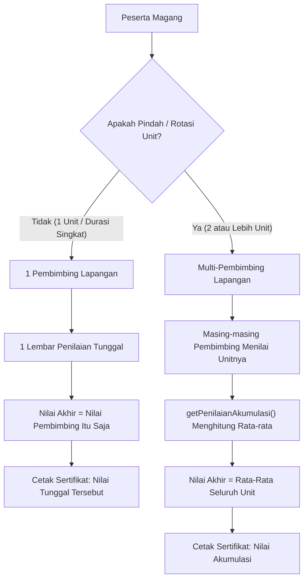

# 📌 Penjelasan Malam Tadi: Sistem Penilaian Magang (1 Pembimbing vs Multi-Pembimbing)

> **Kode Panggilan:** `penjelasan malam tadi`  
> **Waktu Disimpan:** Selasa, 13 Oktober 2026, 22:18 WITA  
> **Status:** Selesai Diimplementasikan & Lolos Seluruh Pengujian (43 Assertions Passing)

---

## 🎯 Ringkasan Konsep Utama

Sistem penilaian magang ini dibangun berdasarkan dokumen [nilai-pembimbing.md](nilai-pembimbing.md) dengan menangani dua skenario utama secara otomatis:

---

## 1. Skenario 1: Magang 1 Pembimbing (Tidak Pindah Unit / Durasi Singkat)

### Cara Kerja:
- Peserta magang ditempatkan di 1 unit/divisi dengan 1 orang pembimbing lapangan.
- Pembimbing lapangan menginput evaluasi nilai peserta (berdasarkan unsur presensi digital objektif dan kriteria manual).
- Sistem otomatis mendeteksi hanya ada **1 evaluasi**.
- Method `getPenilaianAkumulasi()` pada model `Magang` mengembalikan langsung objek penilaian tunggal tersebut dengan tanda `is_akumulasi = false`.

### Tampilan di Antarmuka:
- **Menu Nilai Saya (Anak Magang):** Menampilkan lembar nilai tunggal dari pembimbingnya tanpa membingungkan anak magang dengan kartu akumulasi atau riwayat unit lain.
- **Sertifikat Kelulusan:** Nilai yang dicetak adalah nilai tunggal dari pembimbing tersebut beserta predikatnya (contoh: `[B (Baik)]`).
- **Dashboard Pembimbing:** Menampilkan lembar nilai seperti biasa tanpa tombol beralih unit.

---

## 2. Skenario 2: Magang Multi-Pembimbing (Rotasi Antar Unit/Divisi)

### Cara Kerja:
- Contoh: Peserta magang selama 6 bulan, di mana 2 bulan di Subbag TU (dibina Pembimbing A) dan 4 bulan di Bidang Pelayanan Informasi (dibina Pembimbing B).
- Pembimbing A menginput penilaian untuk penempatan unitnya (skor presensi dihitung otomatis hanya untuk rentang tanggal penempatan unit A).
- Pembimbing B menginput penilaian untuk penempatan unitnya (skor presensi dihitung otomatis hanya untuk rentang tanggal penempatan unit B).
- Method `getPenilaianAkumulasi()` pada model `Magang` secara cerdas menghitung:
  1. **Nilai Total Rata-Rata:** Rerata dari seluruh nilai akhir yang diinput para pembimbing.
  2. **Predikat & Keterangan Akumulasi:** Dikonversi otomatis dari nilai rata-rata (misal: 85 -> B / Baik).
  3. **Rincian Per Kriteria:** Nilai rata-rata untuk setiap kriteria penilaian diakumulasikan.
  4. **Koleksi Evaluasi:** Menyimpan rincian penilaian masing-masing pembimbing untuk histori.

### Tampilan di Antarmuka:
- **Menu Nilai Saya (Anak Magang):**
  - Di atas: Banner nilai akhir akumulasi (contoh: Skor 85, Predikat B).
  - Di bawah: Rincian evaluasi terpisah dari Pembimbing A dan Pembimbing B lengkap dengan unit kerja masing-masing.
- **Sertifikat Kelulusan:**
  - Mengambil nilai akhir akumulasi (rata-rata) sehingga yang tercetak di sertifikat resmi adalah performa menyeluruh anak magang selama di instansi.
- **Tampilan Pembimbing:**
  - Saat membuka lembar nilai, terdapat banner info bahwa peserta ini memiliki akumulasi dari beberapa unit penempatan beserta tombol untuk berpindah melihat lembar nilai unit lainnya.
- **Tampilan Admin:**
  - Pada tabel rekapitulasi penilaian terdapat badge informasi: `Rata-rata 2 mentor`.
  - Admin dapat membuka lembar nilai individual per unit penempatan.

---

## 3. Rincian Teknis & Database

### Perubahan Database:
- Migration: `2026_10_13_211522_update_penempatan_and_penilaian_for_multi_pembimbing.php`
  - Menambahkan kolom `pembimbing_id` pada tabel `penempatan_magang` (menentukan siapa pembimbing di unit tersebut).
  - Menambahkan kolom `penempatan_magang_id` pada tabel `penilaian` (mengaitkan lembar nilai dengan unit kerja tertentu).
  - Mengubah unique constraint `magang_id` menjadi non-unique index agar 1 peserta magang dapat memiliki lebih dari 1 penilaian (1 penilaian per pembimbing/unit).

### Service & Logika:
- `PresensiScoreService`: Menerima parameter opsional `$penempatan` agar penghitungan jam kerja dan persentase kehadiran dibatasi sesuai tanggal mulai dan tanggal selesai di unit penempatan terkait.
- `Magang::getPenilaianAkumulasi()`: Menjadi titik tunggal (*single source of truth*) yang transparan bagi tampilan sertifikat, tampilan magang, maupun admin.

---

## 4. Hasil Pengujian (Test Suite)

Pengujian fitur baru dibuat di:
- `tests/Feature/PenilaianMultiPembimbingTest.php`
- **Status:** `PASSED (2 tests, 43 assertions)`:
  1. `test_single_mentor_produces_single_evaluation_and_same_accumulated_score` -> **Lolos**
  2. `test_multiple_mentors_can_evaluate_distinct_unit_placements` -> **Lolos**

---

*Catatan: Dokumen ini siap dibuka kembali kapan saja saat Anda mengetik `penjelasan malam tadi`.*
